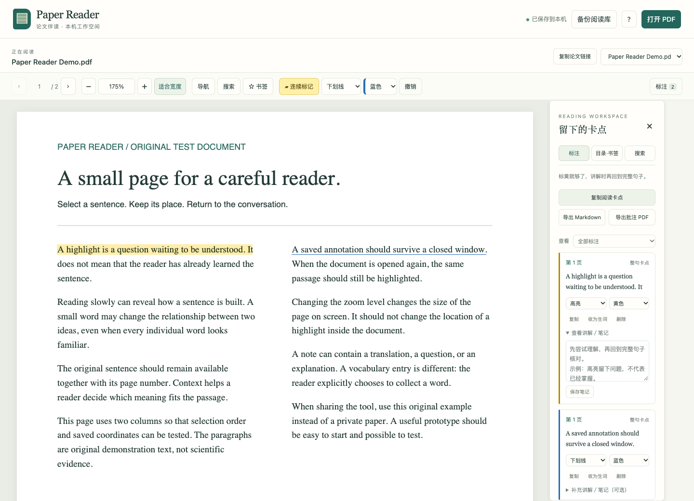

# Paper Reader

[简体中文](README.md) | English

[](https://github.com/JXC240/paper-reader/actions/workflows/ci.yml)
[](LICENSE)

**Let AI read with you. Keep the thinking yours.**

A local PDF reading companion for research papers. Read a passage yourself, mark what needs attention, and take the original sentence and context into a conversation with AI.

**Read first → Annotate → Discuss with AI → Return to the original → Review over time**



*The current interface is primarily in Chinese. This guide explains the controls in English.*

## Why it exists

I wanted to read an English paper beside my GPT conversation, but the built-in PDF viewer did not offer the annotation workflow I needed. Copying passages, restoring their context, and adding page numbers interrupted reading. Writing a comment on every unfamiliar phrase made a quick mark unnecessarily complicated.

Paper Reader gives that process a place: try a short passage first, mark what you want to understand, discuss it, then return to the English. Recognizing sentence structure, academic expressions, and an author's argument takes repeated practice. **That is the project's learning goal, not a measured learning outcome or a promise of fluency.**

## What you can do

| While reading | Paper Reader helps with |
| --- | --- |
| Mark a question immediately | Continuous marking or select-first mode; seven colors, highlights, underlines, and strikeouts |
| Pick up where you stopped | Persistent annotations, notes, bookmarks, page, zoom, and within-page position; note draft protection |
| Find the source again | Full-text search, embedded PDF outline, page bookmarks, and keyboard navigation |
| Bring context into a conversation | Selected text, page and nearby passages; copied reading questions and a stable paper link |
| Keep your work portable | Markdown, standard annotated PDF copies, and full-library backup with separate recovery |
| Open it for everyday use | A local webpage; optional macOS login service and restart after process exit |

## Start in three steps

You need **Python 3.10+** and an internet connection for the initial setup. Reading and saving then work offline. Node.js and a model API key are not needed for everyday use.

1. **Download and start.** [Download the source ZIP](https://github.com/JXC240/paper-reader/archive/refs/heads/main.zip) and extract it to a separate folder. On macOS, double-click `启动阅读器.command` (“Start reader”), or run in the project directory:

   ```sh
   ./start.sh
   ```

2. **Try the example.** Open [the local reader](http://127.0.0.1:8877/) on the same computer and click “试试示例 PDF” (“Try demo PDF”). Select a sentence to mark it. In foreground mode, leave the terminal open; Control+C stops the service.

3. **Read your paper.** Open your PDF in a normal browser, or a desktop chat app that supports a local built-in browser. After reading a passage, click “复制阅读卡点” (“Copy reading questions”) and paste it into your conversation. An assistant with authorized local file access can read the paper-specific record instead.

For different papers in different chats, use “复制论文链接” (“Copy paper link”) to keep each chat on its own document. These links work with this library on this computer; they do not publish a PDF or grant remote access.

[Usage, background service, backup, and upgrades](docs/USAGE.en.md) · [Copy-ready installation, reading, Obsidian, and weekly review prompts](docs/WORKFLOWS.en.md)

## Build a reading habit

A highlight might mark a question, a method, or something worth revisiting. It does not automatically classify a word as vocabulary. Try to state a sentence's meaning first, ask AI to explain it in context, then return to the original and paraphrase it yourself.

Optionally, authorize a capable assistant to save confirmed vocabulary, expressions, and difficult sentences in Obsidian. Review them by recalling first and checking the original afterwards. The prompt guide includes templates. AI explanations, vault writing, and scheduled reviews are performed by your chosen assistant, not automatically by Paper Reader.

## Your data

Imported PDF copies and saved records live in the project's `data/` directory. Original files are preserved. Unsaved note drafts also attempt to stay in the current browser; they enter the library, exports, and backups only after “保存笔记” (“Save note”).

“备份阅读库” (“Back up library”) downloads a ZIP of your papers and saved records. Recovery validates the archive and writes to a new directory. Back up and verify recovery before moving computers or upgrading. See the [usage guide](docs/USAGE.en.md).

Paper Reader does not send papers to a model or cloud service. Content you paste into AI or authorize an assistant to read enters that application's workflow. Git history contains source code, not your personal reading library. Keep library backups out of public repositories.

## Support and limits

- **macOS** is the main manually tested platform. Linux has a startup script and automated checks; a Windows one-click setup has not been verified.
- The current interface is primarily Chinese; English guides and prompts are available.
- Reading is page by page. Continuous scrolling, OCR, cross-page selections, figure-region annotations, and multi-step undo/redo are not implemented.
- Columns, hyphenation, formulas, and the PDF text layer can affect extraction. Verify quotations and scientific claims against the original.
- The sidebar manages annotations added with this tool. Existing PDF annotations are preserved in exported copies but are not automatically imported into the sidebar.
- `127.0.0.1` refers to the current device. Side-by-side browsing and local file access depend on your chat client.

## Help improve it

[Report a problem or suggest a feature](https://github.com/JXC240/paper-reader/issues/new/choose) with the reading task and reproduction steps. Use self-authored examples and remove personal PDFs, annotations, and paths.

[Contributing](CONTRIBUTING.md) · [Development and tests](docs/DEVELOPMENT.md) · [Releasing](docs/RELEASING.md) · [Roadmap](docs/ROADMAP.md) · [Changelog](CHANGELOG.md) · [Validation](docs/VALIDATION.md) · [Security](SECURITY.md)

Current version: **v0.4.0**. Built with Mozilla PDF.js, pypdf, and a local Python server. Original code is MIT licensed; see [third-party notices](THIRD_PARTY_NOTICES.md). Developed through reader needs, hands-on feedback, and AI collaboration.
