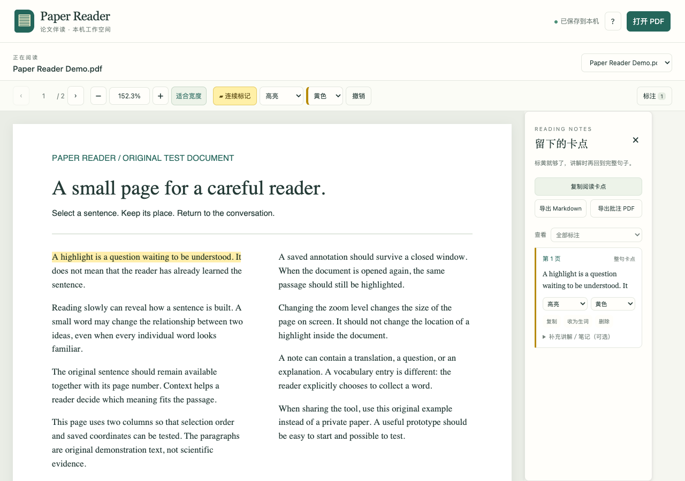

# Paper Reader · 论文伴读

简体中文 | [English](README.en.md)

**让 AI 陪你读，把理解留给自己。**

先读英文原文，随手标出卡点，再带着完整句子与 AI 讨论。一个本地运行的 PDF 阅读伴侣，让论文、对话和长期学习积累接在一起。

**自主阅读 → 随手标注 → AI 伴读 → 回到原文 → 积累与复习**



## 为什么做 Paper Reader

这个项目来自一个很具体的需要：**我想在 GPT 聊天旁边自己读英文论文，但内置 PDF 查看器的阅读与标注体验，还不能完全满足我的需要。**

遇到生词、长难句或看不懂的方法时，我希望先顺手标一下，读过一段，再和 AI 一起拆解。如果每个问题都要切换窗口、复制文字、补上页码，阅读很容易被打断；逐处写一条“没看懂”，也让简单的标记变得繁琐。

更重要的是，我希望长期培养**直接阅读英文论文的能力**：逐渐能从英文原文里抓住句子的主干、理解学术表达，沿着作者的论证读下去。这里说的“原生英语论文阅读能力”，是这样一种需要长期练习的能力，而不只是拿到一份中文译文。

Paper Reader 希望给这种练习一个顺手的环境：**先自己读，遇到困难再找 AI；讨论以后，再回到英文原文试着读懂。** 今天读过的一句、反复遇到的一个表达，都可以成为下一次阅读和复习的起点。

这是项目的学习目标与使用理念，尚未开展学习效果评估；使用工具、保存笔记或听过讲解，都不等于已经掌握。

## 一段论文，可以这样读

1. **先尝试理解。** 打开论文，自己读一小段，试着抓住它在讲什么。
2. **随手留下线索。** 不懂的句子、关键方法或值得回看的地方，选中就标；不必每处写评论。
3. **带着原文找 AI。** 让 AI 结合完整句子和上下文，解释词义、短语搭配、主干与修饰关系。
4. **回到英文再读一次。** 尝试用自己的话复述，检查自己是否真的理解，而不只停留在“看过翻译”。
5. **把值得积累的内容留下。** 将确认要收录的词汇、表达和长难句整理进 Obsidian，每周回看、回忆和复习。

阅读节奏由你掌握。可以一段一段精读，也可以先快速筛选；不要求每篇论文逐字读完。高亮表示“这里值得关注或继续理解”，不自动等于生词，也不代表已经学会。

## 它能帮你做什么

| 阅读中的需要 | Paper Reader 提供的支持 |
| --- | --- |
| 读的时候顺手标 | 连续标记、选文模式；七种颜色，高亮／下划线／删除线 |
| 下次继续读 | 标注与笔记持久保存，恢复页码、缩放和页内阅读位置 |
| 在论文里找内容 | 全文搜索与文字定位、PDF 自带目录、可命名页面书签 |
| 把卡点带进对话 | 保存选文、页码、位置及附近原文；复制卡点或导出 Markdown |
| 保留阅读积累 | 可选笔记、主动收为生词、Markdown 与标准批注 PDF 副本导出 |
| 在 Mac 上日常使用 | 可选后台服务：登录启动、退出后自动重启、运行日志、停止与卸载入口 |

本工具不内置 AI 模型，不需要模型 API key。AI 讲解使用你选择的聊天工具；Paper Reader 负责让原文、标注与位置可保存、可回查。

## 三步开始使用

需要 **Python 3.10 或更新版本**。首次准备环境需要联网，之后阅读和保存可以离线使用；AI 对话另需相应的应用与连接。

### 1. 下载并启动

从本仓库下载 ZIP 并解压，或使用 Git 获取源码。macOS 用户双击 **`启动阅读器.command`**；它会准备项目自己的 Python 环境、安装固定依赖和 PDF.js 资源，然后打开阅读器。

也可以在项目目录运行：

```sh
./start.sh
```

默认地址是 **http://127.0.0.1:8877/**。初次运行建议先点击“试试示例 PDF”。不要把其他人的私人论文作为公开测试文件。

默认前台模式需要保留启动窗口，按 Control+C 可停止。macOS 后台运行是可选功能，见下文；下载源码本身不会安装登录项。

### 2. 把论文放在聊天旁边

在支持内置浏览器的 **ChatGPT 桌面端**中打开这个本机地址，切换为聊天与页面并排显示，就可以一边读论文、一边继续当前对话。普通浏览器也能独立使用阅读器。桌面内置浏览器与并排显示的操作见 [OpenAI 官方浏览器说明](https://learn.chatgpt.com/docs/browser)。

请使用**运行阅读器的同一台电脑上的浏览器**。`127.0.0.1` 指当前设备，不是公开网址；另一台电脑、手机或云端浏览器不能仅凭这个地址访问你的本机阅读器。客户端功能与权限也可能不同。

### 3. 先读、标注，再讨论

点击“打开 PDF”，选择论文。默认开启连续标记，选中文字后自动保存；也可切换选文模式，先选择，再决定标记或复制。

- **助手有本机文件权限：**按你的要求读取项目里的 `data/current-reading.json`，获得当前论文、标注和附近原文。
- **助手没有本机文件权限：**点击“复制阅读卡点”，粘贴到聊天；或导出 Markdown，再交给助手。

仅打开阅读页面，不会自动把选文发送给 AI；标注也不会自动触发讲解。

## 复制就能用的提示词

下面是使用模板，不是已执行的操作。请替换尖括号里的内容。安装与写入本地文件需要相应权限；没有权限的聊天应给出手动步骤或 Markdown，而不是声称已经操作成功。

### ① 请 AI 帮我安装阅读器

把下面的提示词交给具有本机执行能力的桌面助手：

```text
请帮我在本机安装并运行 Paper Reader。
仓库链接：https://github.com/JXC240/paper-reader

先检查我的操作系统、Python 环境和仓库 README，核对安装脚本与依赖。
将项目放在合适的独立目录，告诉我实际保存位置；不要覆盖已有项目或阅读数据。
使用项目自己的 Python 环境，不修改全局 Python，不关闭证书验证，不开放公网端口。
按 README 准备依赖、启动服务，并验证本机阅读页面能够打开。
如果端口已占用，先辨认是什么程序，不要直接结束其他进程。
macOS 的登录后台项请先向我说明并征得同意，不默认安装。
完成后告诉我如何启动、停止和备份。若你没有本机执行权限，请给我手动步骤，不要声称已安装。
```

### ② 在 GPT 聊天旁打开阅读器

前提：本机服务已启动，客户端支持本机内置浏览器。

```text
请用当前桌面端的内置浏览器（@Browser），在这个对话旁边打开：
http://127.0.0.1:8877/

这是本机运行的 Paper Reader。请保留当前对话，尽量让聊天和阅读页面并排显示。
先验证能看到阅读器，不要把仅打开了标签页当作加载成功。
如果连接被拒绝，先检查本机阅读器是否启动；不要把“本机地址打不开”当作需要上传论文或部署到公网。
如果当前环境没有本机浏览器能力，请说明限制，给我在普通浏览器打开的步骤。
```

### ③ 让 AI 陪读，而不是跳过我的理解过程

```text
我正在用 Paper Reader 阅读英文论文，想长期练习直接理解英文原文。
项目目录：<Paper Reader 的本机绝对路径>

若你有本机文件权限，请读取 data/current-reading.json，核对当前论文与标注。
若没有权限，我会粘贴“复制阅读卡点”的内容；不要假装看到了我的文件。

从我指定的阅读位置，按原文顺序逐句推进，每次先处理一个完整句子。
先让我尝试说出大意或指出卡点，再给出英文原文、准确整句翻译、意义块、短语搭配与句子主干。
结合上下文解释，不要只把标黄内容逐词列成词典；必要时补足前文连接。
公式、数字和专业结论回到 PDF 核对，无法确认的地方明确标记。
讲解后让我回到英文再读、用自己的话复述；不要把“你解释过”当作“我已掌握”。

先在聊天里讲解，只有我确认需要收录时，再整理词汇或笔记。
```

### ④ 将确认过的学习内容写入 Obsidian

Obsidian 是可选的积累环节，不影响阅读器本身的使用。以下操作由你授权的助手完成，**不是 Paper Reader 自动同步**。本地文件访问取决于客户端、系统及工作区权限，见 [OpenAI 本地访问说明](https://learn.chatgpt.com/docs/enterprise/chatgpt-work-local-security)。

```text
请把本次论文阅读中，我明确确认要收录的词汇、学术表达和长难句整理到 Obsidian。
库路径：<我的 Obsidian 库的本机绝对路径>
目标目录：<库内的英语论文阅读目录>
Paper Reader 项目目录：<项目的本机绝对路径>

先检查现有笔记结构，沿用已有分类并去重；论文英语与小说、日常英语分开。
每条保留：英文原句、论文名称、可核对的 PDF 页码、日期、准确中文翻译、词义或搭配解释、我的具体卡点。
把 AI 解释与论文原文分开；没有来源的内容不要补造，讲解过不记为已掌握。
仅追加或更新本次相关条目，不删除或覆盖旧笔记，不修改原 PDF。
完成后给出实际写入文件的路径，并检查保存结果。
如果没有写入权限，请生成可直接保存的 Markdown，明确说明尚未写入，不要声称已同步。
```

### ⑤ 每周做一次论文英语复习

让笔记重新回到阅读中：先回忆，再核对原句，再尝试在新句子里理解同一种表达。下面的模板用于**本周手动复习**，不会自行创建定时任务。

```text
请根据我 Obsidian 中本周实际保存的论文英语笔记，做一次英语阅读复习。
库路径：<我的 Obsidian 库的本机绝对路径>
论文英语目录：<库内目录>
本周范围：<开始日期至结束日期>

先核对真实笔记和来源，不补造本周没读过的内容。
按“词汇与搭配、长难句结构、学术表达、仍有疑问的内容”整理，并列出本周来源清单，避免漏项。
第一轮先给小测：原句回忆、结合上下文选词义、找主干和短句复述，不要立即给出答案。
等我作答后，再核对并解释；区分“已收录、已复习、这次答对、仍需练习”，不直接宣布已掌握。
按已有结构保存本周总结，不覆盖无关笔记；给出实际写入路径。没有写入权限则提供 Markdown。
最后结合我的实际表现，建议下周最值得反复练习的少量表达，不把建议写成我已确认的计划。
```

如果希望每周自动整理，可再明确要求助手创建或更新定时任务，并先确认时间、时区、执行环境与本地库权限。**写下一条提示词，不等于定时任务已经启用**；电脑休眠时，本机文件不一定可访问。遇到权限或自动化限制，可先采用手动周复习。

## macOS：可选的后台运行

想在日常阅读时不保留终端窗口，可以显式安装当前用户的后台服务：

1. 如果已有前台阅读器，先等待“已保存到本机”，在它的启动窗口按 Control+C 停止。
2. 双击 **`安装后台服务.command`**，按提示准备环境并安装。它不会自动结束其他占用端口的程序。
3. 以后直接打开本机地址；双击 **`启动阅读器.command`**也会复用已安装的后台服务。

| 操作 | 入口与效果 |
| --- | --- |
| 安装 | `安装后台服务.command`：登录后启动，服务退出后由 macOS 重新拉起 |
| 停止 | `停止后台服务.command`：停止并禁用自启，保留配置与阅读数据 |
| 再启用 | `启动阅读器.command`：重新启用已安装的后台服务 |
| 卸载 | `卸载后台服务.command`：移除本项目后台项，保留论文、标注、日志与配置备份 |

无需管理员权限，只监听 `127.0.0.1:8877`。配置位于 `~/Library/LaunchAgents/local.paper-reader.plist`，日志位于 `~/Library/Logs/PaperReader/`。不改变合盖或休眠设置；休眠期间不承诺服务响应，也不要求电脑持续保持清醒。

后台托管已在本机验证自动重启；隔夜合盖、实际重新登录等场景仍需后续使用验证。移动项目目录前应先卸载后台项，移动后重新安装。异常退出保护不能代替数据备份。

## 日常操作速查

- **自由缩放：**输入25%—400%，支持小数；−／+每次调整10个百分点，⌘／Ctrl +、−、0对应放大、缩小、适合宽度。
- **搜索：**⌘／Ctrl F；输入单词或短语后查找，忽略大小写并折叠空白，最多500处；Enter／Shift Enter切换结果。橙框只是临时定位，不保存为标注。
- **取消选文：**点空白、Esc、滚动或菜单×；不会因取消而保留遮挡菜单。
- **调整标注：**右侧卡片可换颜色、换样式、补笔记、主动收为生词；删除线不删除原文，也不代表原文错误。
- **目录与书签：**“导航”中查看PDF内置目录、收藏页面并命名。无内置目录会提示；书签定位到页。
- **保存与导出：**等待“已保存到本机”；Markdown便于迁移笔记，批注PDF为独立副本，原PDF不覆盖。

## 数据、隐私与备份

```text
data/
  documents/<PDF内容的SHA-256>/
    original.pdf          # 导入的原件副本
    record.json           # 标注、原文上下文、笔记、书签与阅读位置
  current-reading.json    # 当前论文与标注的本机读取入口
  current-reading.md      # 可读快照
  exports/                # 导出的Markdown与批注副本
```

备份整个 `data/` 即可保留论文与记录。同一PDF改名导入复用原记录；内容改变会识别为另一份文档。源码的Git版本不包含私人阅读数据，切换旧代码也不会自动回退标注。

PDF与标注默认保存在本机，Paper Reader不主动上传到模型或云端。**你复制内容给AI，或授权助手读取文件时，相关内容会进入所选AI工作流，并按相应应用的数据规则处理；本地阅读不等于AI推理也完全在本机。**

私人PDF、标注、导出笔记、环境与本机配置被Git忽略；公开示例为自制内容。上传GitHub前仍应检查暂存文件，不要将整个工作目录直接打包公开。

## 已知边界

- 当前是**本地网页式阅读伴侣**，不是官方ChatGPT插件商店条目，也不是Chrome扩展；并排使用依赖客户端实际能力。
- 不内置AI问答，不自动发送消息，不自动写入Obsidian，也不自带每周复习定时器；上面的提示词用于衔接有相应权限的助手。
- 仍是逐页阅读，无连续滚动、扫描件OCR、跨页一次选文、图表框选或多步撤销／重做。
- 双栏、连字符、连字和公式可能影响文本提取与阅读顺序；附近文本、翻译和科学结论需回原PDF核对。
- 原PDF已有批注会显示并在导出时保留；侧栏管理本工具新增的标注，尚未自动导入旧批注。
- 页内位置尽量按相对视野中心恢复，靠近边缘或改变布局时不保证像素级一致。
- 主要在macOS实测；Linux可使用`start.sh`，Windows及其他客户端尚未完成完整验证，不承诺一键安装。

## 版本与开发

当前代码版本 **v0.3.1**：在v0.3.0的搜索／目录／书签／页内位置之上，增加可选macOS后台托管，并处理服务重启后的页面会话恢复。中文与英文说明介绍同一版本的功能与使用流程。早期开发历史与六个版本标签保留在维护者本机，GitHub从首次源码发布开始记录；旧版变化见[CHANGELOG](CHANGELOG.md)。

实现使用 [Mozilla PDF.js](https://github.com/mozilla/pdf.js) 渲染文本和页面，[pypdf](https://github.com/py-pdf/pypdf) 导出标准PDF批注；Python本机服务原子保存记录。依赖固定，日常运行无需Node.js；原创代码采用MIT许可，第三方说明见 [THIRD_PARTY_NOTICES.md](THIRD_PARTY_NOTICES.md)。

```sh
# Python单元与HTTP测试：使用临时目录，不接触日常阅读库
.venv/bin/python -m unittest discover -s tests -p 'test_*.py' -v

# 搜索纯函数测试：需要Node.js，无需npm依赖
node --test tests/search.mjs

# 浏览器检查：额外安装开发依赖和测试浏览器
npm install
npx playwright install chromium
npm run test:browser
```

仓库提供`pnpm-lock.yaml`，也可使用pnpm。浏览器检查使用独立临时库；`PAPER_READER_BROWSER_CHANNEL=chrome`可选本机Chrome，`PAPER_READER_TEST_PDF`可添加本机论文回归。真实论文与测试截图不应提交。

验证范围见 [验证记录](docs/VALIDATION.md)，版本变化见 [CHANGELOG](CHANGELOG.md)，项目目标见 [PLAN](PLAN.md)。软件测试通过不等于学习效果已验证。

项目由读者提出需求、试用反馈，结合AI协作迭代。欢迎反馈具体阅读场景、复现步骤与不含私人论文的示例，一起把长期阅读这件事做得更顺手。
